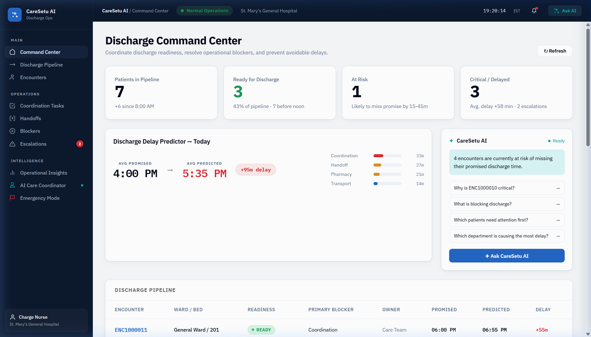
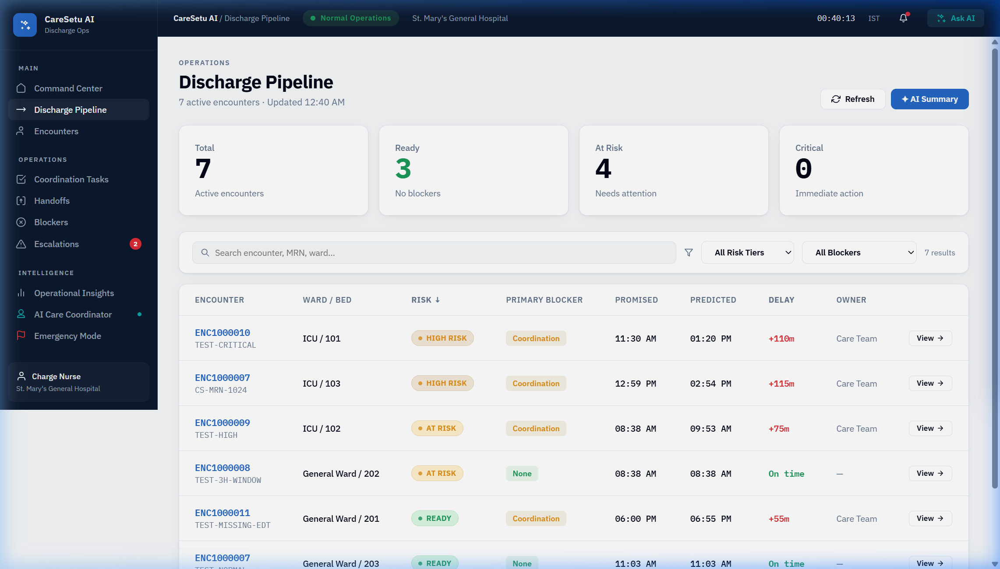
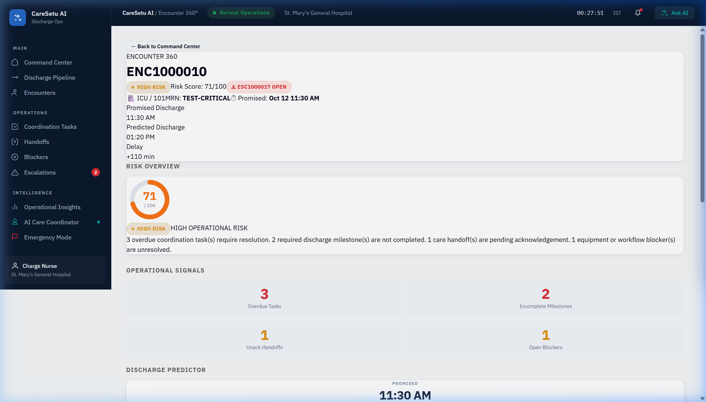
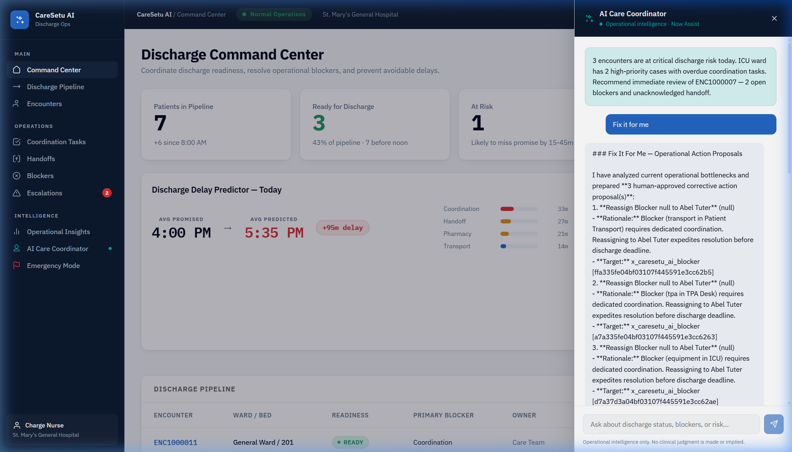
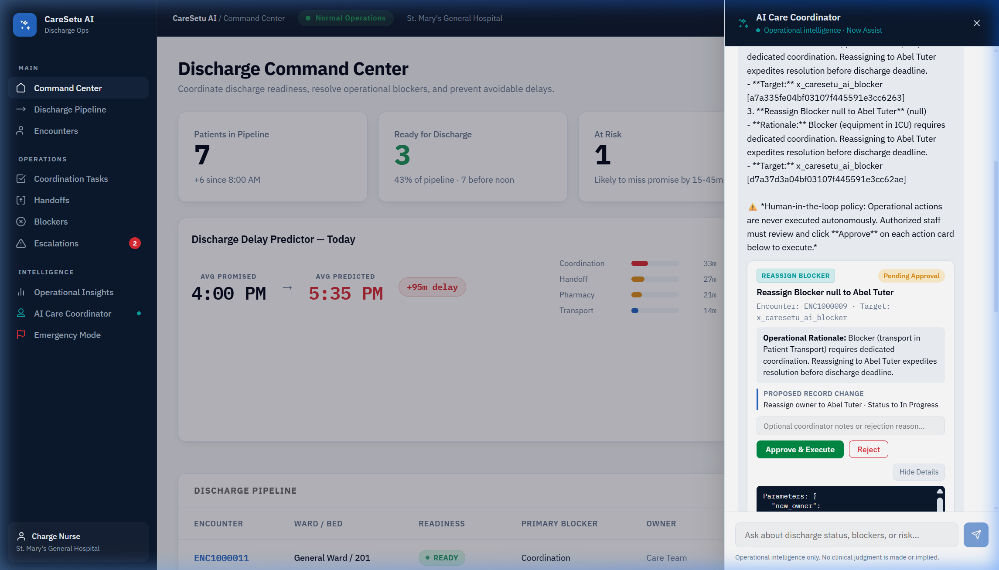
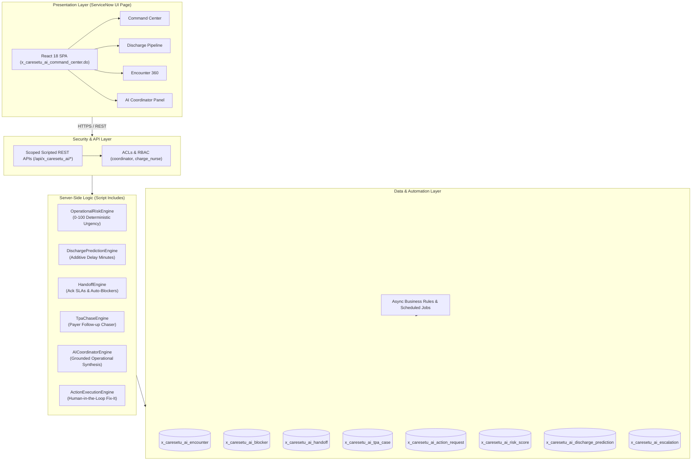

# CareSetu AI

> **Operational Bridge for Inpatient Discharge on the ServiceNow Platform**

---

## About CareSetu AI

In acute care hospitals, a patient being declared medically fit for discharge rarely means they can actually go home. A doctor might sign the discharge order at 10:00 AM, yet the patient sits in a room or recovery chair until late afternoon — waiting on a pending insurance pre-authorization, an unacknowledged nurse shift handoff, take-home medication delivery from pharmacy, or patient transport.

These delays cost hospitals thousands of inpatient bed-hours every month and keep new emergency room admissions waiting for open beds.

**CareSetu AI** addresses this problem by treating discharge coordination as an operational workflow directly on ServiceNow (`x_caresetu_ai`). It provides charge nurses, care coordinators, and hospital leadership with real-time visibility into non-clinical discharge bottlenecks, calculates transparent operational urgency scores, and provides human-approved corrective actions to resolve blockers before discharge deadlines breach.

---

## Screenshots

### 1. Discharge Command Center
The central operational dashboard displaying active inpatients, promised vs. predicted discharge times, open bottlenecks, and real-time urgency triage.



---

### 2. Discharge Pipeline
A workflow board categorizing inpatient encounters across operational stages, tracking delay minutes and assigned owners for each bed.



---

### 3. Encounter 360 Deep-Dive
A consolidated 360-degree telemetry view for an individual patient encounter showing active operational signals, overdue coordination tasks, pending milestones, and open blockers.



---

### 4. Grounded AI Care Coordinator
A conversational operational assistant grounded exclusively in active ServiceNow table records. It delivers situational briefings without hallucinating clinical facts.



---

### 5. "Fix It For Me" Human-Approved Action Lifecycle
Auditable human-in-the-loop action proposals. The AI suggests corrective workflows (e.g., reassigning an overdue transport blocker or escalating an insurance hold), but the database is never modified until an authorized nurse or coordinator explicitly approves the action.



---

## Core Features

- **Discharge Coordination & Bed Board:** Consolidated tracking of patients approaching discharge across wards (ICU, CCU, General Wards) with visibility into promised vs. predicted departure times.
- **Deterministic Operational Risk Scoring (0–100):** Real-time urgency triage (Normal, Medium, High, Critical) computed mathematically by `OperationalRiskEngine` based on overdue tasks, pending milestones, unacknowledged handoffs, and active blockers — completely separate from clinical vital signs.
- **Linear Additive Delay Prediction:** Transparent delay clock calculated in minutes by `DischargePredictionEngine` based on specific blocker categories (pharmacy, transport, billing, equipment), with automatic deduplication so delays are never double-counted.
- **Closed-Loop Blocker & Escalation Tracking:** Dedicated records for each operational roadblock (`x_caresetu_ai_blocker`) with assigned owners, category tags, SLA targets, and automated escalation to supervisory queues (`x_caresetu_ai_escalation`).
- **Shift & Inter-Unit Handoff SLAs:** Structured handoff management (`x_caresetu_ai_handoff`) with 30-minute acknowledgment timers. Unacknowledged handoffs automatically generate coordination blockers.
- **Insurance / TPA Auto-Chasing:** Systematic tracking of Third-Party Administrator insurance clearances (`x_caresetu_ai_tpa_case`) with automated reminder schedules run via background scheduled scripts.
- **AI Care Coordinator & "Fix It For Me":** Natural language situational summaries backed by a strictly governed action execution engine (`ActionExecutionEngine`). Proposes allowlisted operational changes that execute only after human authorization.

---

## Architecture

CareSetu AI is built as a scoped ServiceNow application (`x_caresetu_ai`) using a defense-in-depth architecture:



1. **Frontend:** React 18 Single Page Application compiled into static assets and hosted inside a native ServiceNow UI Page (`x_caresetu_ai_command_center.do`).
2. **API & Access Control:** Scoped Scripted REST APIs guarded by ServiceNow Access Control Lists (ACLs) and role-based permissions (`x_caresetu_ai.coordinator` and `x_caresetu_ai.charge_nurse`).
3. **Operational Engines:** Deterministic server-side Script Includes handling urgency scoring, delay forecasting, handoff state machines, insurance chasers, and action validation.
4. **Data Tables & Automation:** Eight custom scoped tables with asynchronous Business Rules maintaining synchronized blocker counts, recalculating risk scores on mutation, and scheduled background chasers enforcing SLAs.

For complete architectural details, see [CareSetu AI Technical Report](presentation_pack/CareSetu_AI_Technical_Report.md).

---

## Tech Stack

| Layer | Technologies |
| :--- | :--- |
| **Platform** | ServiceNow (Utah / Washington / Xanadu / Zurich compatible) |
| **SDK & Build Tooling** | ServiceNow SDK 4.13.3 (`@servicenow/sdk`, `@servicenow/glide`) |
| **Source Definition** | ServiceNow Fluent (`.now.ts`), TypeScript |
| **Server Logic** | ServiceNow JavaScript (Script Includes, Business Rules, Scheduled Scripts) |
| **Client UI** | React 18, TypeScript, pure CSS design tokens, Lucide React icons |
| **Package Management** | Node.js (LTS), npm |

---

## Setup & Deployment Guide

### Prerequisites

1. **Node.js**: Ensure Node.js LTS (v18 or v20+) and `npm` are installed:
   ```bash
   node -v
   npm -v
   ```
2. **ServiceNow Instance**: You will need an authorized ServiceNow instance (e.g. a Personal Developer Instance from [developer.servicenow.com](https://developer.servicenow.com)) with `admin` credentials.
   > **Note:** The original hackathon development sandbox (`act-hck-4161-0029.lab.service-now.com`) was temporary and may no longer be online. You will need your own instance to deploy and run live.

### Installation Steps

1. **Clone the repository:**
   ```bash
   git clone https://github.com/Sahil1306i/CareSetu.git
   cd CareSetu
   ```

2. **Install project dependencies:**
   ```bash
   npm install
   ```

3. **Configure ServiceNow SDK authentication:**
   Connect your local SDK environment to your target ServiceNow instance:
   ```bash
   npx now-sdk auth
   ```
   Follow the interactive prompt to provide:
   - **Instance URL:** `https://<your-instance>.service-now.com`
   - **Authentication:** Basic Auth (Username / Password) or OAuth Token.

4. **Fetch dependencies and instance types:**
   ```bash
   npm run types
   ```

5. **Build the application:**
   Compile the React frontend bundle, TypeScript types, and Fluent metadata into installable ServiceNow artifacts:
   ```bash
   npm run build
   ```

6. **Deploy to your ServiceNow instance:**
   Install or update the scoped application on your connected instance:
   ```bash
   npm run deploy
   ```

7. **Open the application:**
   Once deployment completes, open your browser and navigate to:
   ```
   https://<your-instance>.service-now.com/x_caresetu_ai_command_center.do
   ```

---

## Automated Tests

The application includes automated test suites defined in ServiceNow Fluent ATF format (`src/fluent/tests/`):
- `caresetu-test-suite.now.ts` — Core encounter validation & business rule suites
- `handoff-test-suite.now.ts` — Shift handoff creation & SLA breach tests
- `tpa-test-suite.now.ts` — Insurance tracking & case state machine tests
- `test-high-risk-encounter.now.ts` & `test-normal-encounter.now.ts` — Urgency scoring assertions
- `test-rest-scoring.now.ts` — Scoped REST API scoring endpoints

These test suites are compiled during `npm run build` and can be executed directly within your ServiceNow instance using the Automated Test Framework (ATF) runner or via `npx now-sdk cicd`.

---

## Honest Boundaries & Limitations

- **Operational Scope Only:** CareSetu AI tracks logistical, administrative, and interdepartmental coordination signals (transport, equipment, insurance clearances, nursing shift handoffs). It does **not** read medical diagnostics, laboratory numbers, or vital signs, and does not provide clinical diagnoses, medical triage, or patient treatment advice.
- **Simulated Payer & Hospital Integrations:** The application runs on synthetic test encounters and tracks internal SLA timers for insurance coordination. It does not connect to live external health insurance clearinghouse APIs or hospital-wide EHR telemetry.
- **Generative AI Availability:** Generative Now Assist skill bindings are defined via Fluent (`src/fluent/skills/explain-risk-skill.now.ts`). On ServiceNow environments where Now Assist generative models are not licensed or configured, CareSetu AI uses its deterministic in-scope operational synthesis engine (`AICoordinatorEngine.server.js`), which produces reliable, grounded briefings directly from table data.
- **Zero Autonomous Execution:** The AI cannot make unilateral database writes. All actions formulated through "Fix It For Me" strictly require explicit review and authorization by authenticated hospital staff holding appropriate roles.

---

## License

This project is unlicensed (`UNLICENSED` in `package.json`). All rights reserved.
